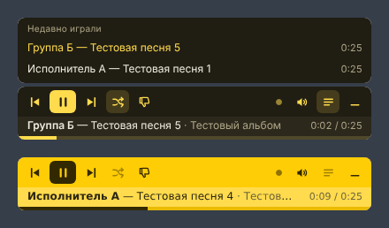

# YMusic — мини-плеер «Мне нравится» из Яндекс Музыки для Windows

**Лёгкий десктопный плеер Яндекс Музыки для Windows.** Синхронизирует ваш плейлист «Мне нравится», хранит MP3 у вас на диске и играет офлайн. Сам плеер — тонкая полупрозрачная полоска поверх окон, которая сворачивается в трей.



**[⬇ Скачать установщик для Windows](https://github.com/susoev/YMusic/releases/latest)** — файл `YMusic-Setup-*.exe`. Дальше программа обновляется сама.

## Возможности

- **Офлайн-синхронизация «Мне нравится».** Треки скачиваются в MP3 (лучшее доступное качество, обычно 320 kbps) и играют с диска. Пока часть ещё качается, остальное уже играет.
- **Фоновая докачка.** Поставили лайк в браузере или на телефоне — трек сам появится в плеере через несколько минут. Сняли лайк — файл удалится с диска.
- **Минимальный интерфейс.** Полоска шириной 400 px поверх всех окон, по центру над панелью задач. В покое полупрозрачная, при наведении становится непрозрачной.
- **Кнопки:** ⏮ предыдущий, ⏯ играть/пауза, ⏭ следующий, 🔀 перемешать (shuffle), 👎 не нравится.
- **Дизлайк** пропускает трек, ставит ему «Не нравится» в Яндексе и снимает с «Мне нравится», файл удаляется. 5 секунд можно нажать «Отменить» — трек вернётся с того же места. Без сети дизлайк отправится при следующей синхронизации.
- **Строка трека** под кнопками: исполнитель, название, альбом, время и прогресс. Клик по прогрессу — перемотка.
- **Громкость колесом мыши** при наведении на значок динамика; клик по значку выключает звук.
- **«Недавно играли»** — последние 10 сыгранных треков, клик по любому запускает его.
- **Трей:** клик прячет и показывает полоску, в меню — пауза, следующий трек, синхронизация, папка с музыкой, конфиг, вход и выход.
- **Продолжает с того же места.** При запуске Windows плеер открыт и стоит на паузе на последнем треке; при ручном запуске сразу играет.
- **Автообновление** из GitHub Releases: в паузе или на стыке треков, без обрыва песни.
- **Вход через окно Яндекса** — без копирования токенов вручную.
- В системной панели Windows (громкость и медиа) видно, что играет.

## Требования

- Windows 10 или 11, x64.
- Аккаунт Яндекса с подпиской **Плюс**: без неё API отдаёт только 30-секундные фрагменты.

## Первый запуск

1. Установите `YMusic-Setup-*.exe` из [Releases](https://github.com/susoev/YMusic/releases/latest).
2. Нажмите «Войти в Яндекс Музыку» на полоске (или «Войти в Яндекс…» в меню трея) и войдите в свой аккаунт.
3. Плеер получит список «Мне нравится» и начнёт качать треки, новые лайки первыми. Первый скачанный трек сразу заиграет.

Точка справа на полоске показывает синхронизацию: мигает — качает, заполнена — всё скачано, красная — нужно войти или нет связи. Подробности — во всплывающей подсказке и в меню трея.

## Конфиг

Трей → **Конфиг**. Это JSON, проверяется при сохранении (Ctrl+S). Файл: `%APPDATA%\YMusic\config.json`.

| Ключ | По умолчанию | Что делает |
|---|---|---|
| `width` | `400` | Ширина полоски, px (300–1200) |
| `color` | `"#FFDB4D"` | Основной цвет; все оттенки выводятся из него |
| `theme` | `"dark"` | `dark` или `light` |
| `opacity_idle` | `0.55` | Прозрачность, когда мышь не над плеером (0.1–1) |
| `font_main` | `"Segoe UI"` | Шрифт (должен быть установлен в системе) |
| `font_size` | `12` | Размер шрифта, px |
| `sync_interval_min` | `10` | Как часто проверять «Мне нравится», минут |
| `history_size` | `10` | Сколько треков в «Недавно играли» |
| `music_dir` | `""` | Папка для MP3; пусто — `%APPDATA%\YMusic\tracks` |

## Где лежат данные

`%APPDATA%\YMusic\`:

- `tracks\` — MP3-файлы вида `Исполнитель - Название [id].mp3`;
- `config.json` — настройки;
- `library.json` — список лайков и метаданные;
- `player.json` — текущий трек, позиция, громкость, shuffle, история;
- `auth.json` — токен Яндекса (только локально, никуда не отправляется, кроме API Яндекса);
- `ymusic.log` — лог для диагностики.

## Вопросы

**Это официальный клиент?** Нет. У Яндекс Музыки нет публичного API. YMusic использует тот же закрытый API, что и официальные приложения; протокол взят из открытой библиотеки [MarshalX/yandex-music-api](https://github.com/MarshalX/yandex-music-api). Если Яндекс что-то поменяет, плеер может временно перестать качать новые треки, при этом уже скачанное продолжит играть. Исправление придёт автообновлением.

**Можно ли делиться скачанными файлами?** Нет. Треки скачиваются для личного прослушивания по вашей подписке; распространять их нельзя.

**Почему только «Мне нравится»?** Так задумано: это плеер «своей» музыки. Рекомендации и «Мою волну» удобнее слушать в браузере.

---

## Для агентов и разработчиков, которые вносят правки

- **Push в `main` = релиз.** GitHub Actions (`.github/workflows/release.yml`) собирает установщик на Windows и публикует релиз `v1.1.<N>` с файлами `.exe`, `.blockmap` и `latest.yml`. Установленные копии проверяют обновления раз в час (и через 10 с после запуска) и ставят их в паузе или при смене трека.
- Правки только в `*.md`, `docs/` и `test/` релиз не запускают.
- Версию в `package.json` руками не меняй — её выставляет CI.
- Перед push прогони тест на поддельном API (ниже): все строки должны быть `PASS`.
- Секретов в репозитории нет и быть не должно: токен Яндекса хранится только в `%APPDATA%\YMusic\auth.json`.

### Устройство

| Файл | Что делает |
|---|---|
| `src/main.js` | Полоска поверх окон, трей, окно входа, автозапуск, IPC, автообновление, лог |
| `src/yandex.js` | Клиент API: аккаунт, лайки, метаданные, ссылка на MP3 (`download-info` + подпись, запасной путь — `get-file-info`) |
| `src/library.js` | Синхронизация «Мне нравится» ↔ диск: докачка по одному, удаление снятых лайков, `library.json` |
| `src/config.js` | Дефолты и валидация конфига |
| `src/store.js` | `player.json` и `auth.json` |
| `src/renderer/bar.*` | Интерфейс и сам плеер (`<audio>`), очередь, shuffle, история, громкость |
| `src/renderer/config.*` | Окно редактирования конфига |
| `test/server.js` | Поддельный API Яндекса для локальной проверки |
| `test/shot.js` | Сценарий проверки и снимки окна |

### Локальная сборка и проверка

```bash
npm ci
npm start          # запуск из исходников
npm run dist       # установщик в dist/ без публикации

# проверка на поддельном API (Linux/WSL: через xvfb-run)
node test/server.js ./some-mp3-folder 8765 &
YMUSIC_SHOT=./shots YMUSIC_API_BASE=http://127.0.0.1:8765 YMUSIC_DL_SCHEME=http \
YMUSIC_AUTH_URL=http://127.0.0.1:8765/oauth YMUSIC_DATA=./tmp-data npx electron .
```

---

## English

**YMusic** is a lightweight, unofficial **Yandex Music desktop player for Windows**. It syncs your **"My favorites" / «Мне нравится»** playlist to local MP3 files, plays them offline, and downloads new likes in the background. Tracks you unlike are removed from disk. The UI is a compact always-on-top mini player bar with prev / play-pause / next / shuffle, track info, mouse-wheel volume and a recently-played list. It minimizes to the system tray, resumes where you left off and auto-updates from GitHub Releases. Built with Electron. Requires a Yandex Plus subscription.

**Keywords:** Яндекс Музыка, Yandex Music, плеер Яндекс Музыки для Windows, офлайн Яндекс Музыка, скачать «Мне нравится», мини-плеер поверх окон, плеер в трее, Yandex Music desktop client, Yandex Music offline player, Yandex Music downloader, mini player, tray music player, Electron.

## Лицензия

[MIT](LICENSE). Проект не связан с ООО «Яндекс»; «Яндекс Музыка» — товарный знак его владельца.
